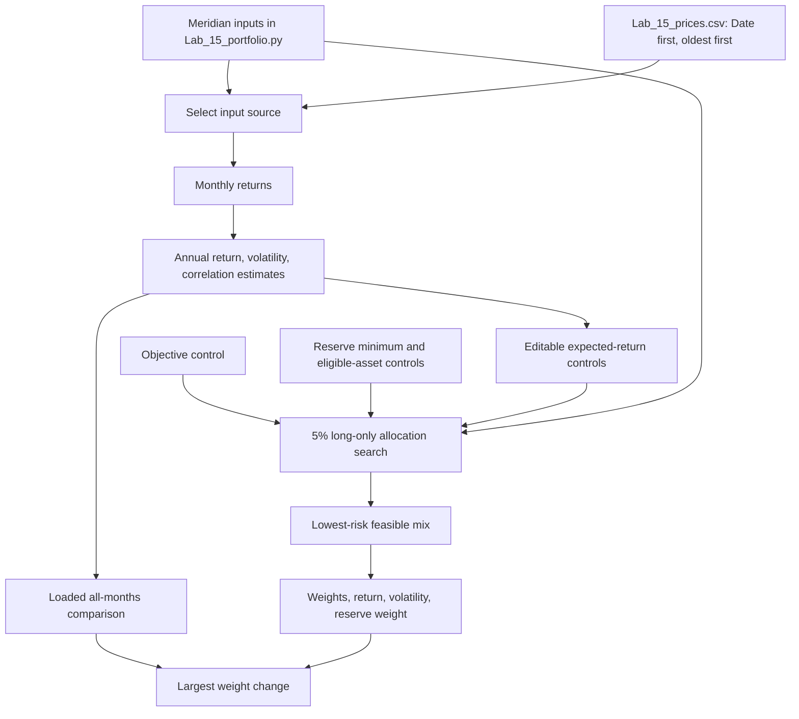

# Lab 15 - Portfolio App and Sensitivity

## R - Universe and mandate inputs

| Input | Meridian training case | My Project 2 case |
|---|---|---|
| Assets | Treasury bills, 10-year Treasuries, investment-grade bonds, global equity | BIL, IEF, LQD, VT |
| Return, volatility, correlation | Lab 14 illustrative tables | Estimated from five years of monthly adjusted-close prices |
| Objective | 6.5% expected return | 6.0% annualized historical-return estimate |
| Hard constraint | At least 3% reserve-eligible weight | At least 10% in BIL |

The Project 2 return is a **historical estimate**, not a forecast.

## My Project 2 mandate

- **Universe:** BIL (cash and reserve), IEF (Treasury bonds), LQD (investment-grade corporate bonds), and VT (global equities).
- **Objective:** earn at least a 6.0% annualized historical-return estimate using the five-year monthly adjusted-price sample.
- **Hard constraint:** hold at least 10% in BIL.

## Partner discussion

Explain the universe, objective, and hard constraint above to a partner without sharing the screen. Record the partner's corresponding mandate here after swapping.

- Partner's universe: BIL (cash reserves), IEF (Treasury bonds), LQD (investment-grade corporate bonds), and VT (global equity).
- Partner's objective: at least a 6.5% annualized historical-return estimate.
- Partner's hard constraint: at least 10% in BIL, treated as the reserve-eligible asset.

## Meridian result

Among the supplied Lab 14 portfolios, the benchmark is the lowest-risk mix that meets the 6.5% return objective. It has a 6.80% expected return and 10.46% volatility. Equal weight and inverse volatility have lower risk, but neither meets the objective.

## Project 2 result

Using 60 monthly adjusted-close observations from November 2021 through October 2026, the lowest-risk 5% allocation that meets the base mandate is:

| Ticker | Weight |
|---|---:|
| BIL | 70% |
| IEF | 0% |
| LQD | 0% |
| VT | 30% |

- Annualized historical return estimate: **6.07%**
- Annualized volatility: **4.54%**

## Project 2: all months versus last 36 months

Using the 5% allocation search, a 6.0% annualized historical-return objective, and BIL as the reserve-eligible asset with a 10% minimum:

| Sample | BIL | IEF | LQD | VT | Return estimate | Volatility | Reserve-eligible |
|---|---:|---:|---:|---:|---:|---:|---:|
| All available months | 70% | 0% | 0% | 30% | 6.07% | 4.54% | 70% |
| Last 36 months | 85% | 0% | 5% | 10% | 6.08% | 1.48% | 85% |

The largest weight change is **20 percentage points** (VT, from 30% to 10%). Both samples produce a feasible mix without lowering the objective.

## Live app verification

With the Project 2 controls set to a 6.0% objective, a 10% reserve minimum, and BIL as the reserve-eligible asset, the uploaded CSV reproduced the documented results. All months produced a 6.07% return estimate, 4.54% volatility, and 70% reserve-eligible weight; the last 36 months produced 6.08%, 1.48%, and 85%, respectively. The displayed largest weight change was **20 percentage points**.

## One-point estimate test

I lowered the VT annualized return estimate by one percentage point while retaining the 6.0% objective and 10% BIL minimum. The mandate still has a feasible lowest-risk mix:

| Ticker | Weight |
|---|---:|
| BIL | 66% |
| IEF | 0% |
| LQD | 0% |
| VT | 34% |

- Annualized historical return estimate under the changed estimate: **6.04%**
- Annualized volatility: **5.13%**

**Conclusion:** the answer survives this one-point change, but it needs 4 more percentage points in VT and volatility rises by 0.59 percentage points. This is a classroom historical-data exercise, not investment advice.

## Partner attack

Partner's disputed estimate or control: My partner lowered the VT expected-return estimate by one percentage point while the last-36-months switch was on.

Result read from the app: The mix changed from 85% BIL / 5% LQD / 10% VT to 85% BIL / 0% LQD / 15% VT. The return estimate was 6.69%, volatility was 1.77%, and the reserve-eligible weight remained 85%.

My two-sentence response: Even after lowering VT's estimated return, the optimizer increased VT because it was still the strongest available source of return needed to meet the objective. This shows estimation risk: a small change to one estimate can change the recommended allocation, so I would pilot the mix rather than adopt it without further validation.

## My call

**Pilot, not adopt:** the lowest-risk mix changes by 20 percentage points in VT when the sample changes from all available months to the last 36 months. Adopt only after the return objective and the reserve policy are validated against the Project 2 mandate rather than this historical sample alone.

## Estimation risk reflection

**What is estimation risk?** It is the risk that inputs estimated from limited historical data, such as expected returns, volatility, and correlations, differ from the values that matter in the future.

**Why an optimizer amplifies small return errors:** the search selects the single lowest-volatility allocation that just clears the return objective. A small change in an estimated return can make one mix fall below the objective and another mix become the new lowest-risk feasible choice, so allocations can shift sharply at the boundary.

**My example:** changing the sample from all available months to the last 36 months reduced VT from 30% to 10%, a 20-percentage-point change. The historical estimate changed enough that the engine found a different lowest-risk way to clear the same 6.0% objective; that is why I would pilot rather than adopt the mix.

Before adoption, I would need a mandate-approved return objective, confirmation of which assets count as reserves, and a robustness review across additional periods and reasonable return and correlation assumptions.

## App and debugging record

The Streamlit app is in `Lab_15_app.py` and runs with:

```powershell
streamlit run Lab_15_app.py
```

An earlier run from the wrong folder produced a file-not-found error. The current Lab 15 engine is `Lab_15_portfolio.py`; it reuses the Lab 14 engine in `lab_14_portfolio.py`.

## Paper app sketch

Complete this portion on paper: draw one box each for `Lab_15_prices.csv`, monthly returns, annualized historical return/covariance estimates, mandate controls, 5% allocation search, and the displayed recommendation. Draw arrows from the return-objective and BIL-minimum controls into the allocation search. Show the sketch to a partner.

## Lab 15 app flowchart


